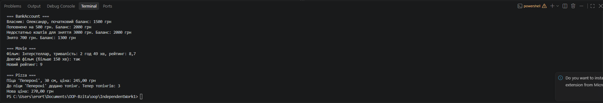

# Самостійна робота №1

> **Тема:** Базовий синтаксис C# і оголошення класів.

---

## Зміст

- [Хід роботи](#хід-роботи)
- [Результати](#результати)

---

## Хід роботи

### 1. Створив проєкт

```bash
dotnet new console -o IndependentWork1
```

### 2. Оголосив власні класи

Створив 3 класи, яких не було у варіантах до лабораторної: `BankAccount`, `Movie`, `Pizza`.

**BankAccount** — банківський рахунок

- Поля: `_owner` (string), `_balance` (decimal)
- Властивості: `Owner` (get/set), `Balance` (тільки для читання)
- Конструктор: `BankAccount(string owner, decimal balance)`
- Методи: `Deposit(decimal amount)` — поповнює рахунок, перевіряє що сума більша за 0; `Withdraw(decimal amount)` — знімає гроші, якщо їх достатньо, і повертає `true/false`

**Movie** — фільм

- Поля: `_title` (string), `_duration` (int, хвилини), `_rating` (double)
- Властивості: `Title`, `Rating` (get/set), `Duration` (тільки для читання)
- Конструктор: `Movie(string title, int duration, double rating)`
- Методи: `IsLong()` — перевіряє чи фільм довший за 150 хв; `PrintInfo()` — виводить інформацію, тривалість переводить у години та хвилини

**Pizza** — піца

- Поля: `_name` (string), `_size` (int, см), `_toppings` (int)
- Властивості: `Name` (get/set), `Size` (тільки для читання)
- Конструктор: `Pizza(string name, int size, int toppings)`
- Методи: `CalculatePrice()` — рахує ціну за розміром і кількістю топінгів; `AddTopping()` — додає один топінг

```csharp
class BankAccount
{
    private string _owner;
    private decimal _balance;

    public decimal Balance
    {
        get { return _balance; }
    }

    public bool Withdraw(decimal amount)
    {
        if (amount > _balance)
        {
            Console.WriteLine($"Недостатньо коштів для зняття {amount} грн. Баланс: {_balance} грн");
            return false;
        }
        _balance -= amount;
        Console.WriteLine($"Знято {amount} грн. Баланс: {_balance} грн");
        return true;
    }
}
```

### 3. Продемонстрував роботу класів

У `Main` створив по одному об'єкту кожного класу через конструктор і викликав їхні методи:

- для `BankAccount` поповнення, спроба зняти більше ніж є на рахунку (перевірка спрацьовує) і нормальне зняття;
- для `Movie` вивід інформації, перевірка `IsLong()` та зміна рейтингу через властивість;
- для `Pizza` розрахунок ціни, додавання топінга і перерахунок ціни.

---

## Результати


