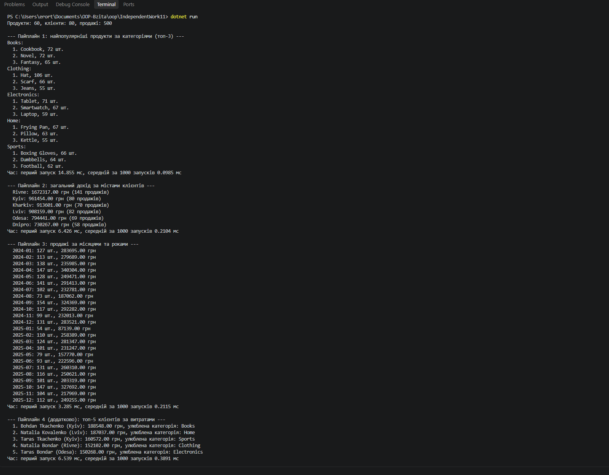

# Самостійна робота №17

> **Тема:** LINQ pipelines: ETL та аналітика
> **Студент:** Бзіта Олександр

---

## Зміст

- [Хід роботи та навички](#хід-роботи-та-навички)
- [Результати](#результати)
- [Звіт](#звіт)

---

## Хід роботи та навички

### 1. Створив проєкт
Ініціалізував консольний проєкт `IndependentWork11` через .NET CLI.

```bash
dotnet new console -o IndependentWork11
```

### 2. Створив класи сутностей

- `Sale` має поля `Id`, `ProductId`, `Quantity`, `SaleDate`, `CustomerId`.
- `Product` має поля `Id`, `Name`, `Category`, `UnitPrice`.
- `Customer` має поля `Id`, `Name`, `City`.

Властивості лише для читання, значення задаються через конструктор. Результати пайплайнів повертаються у вигляді `record`-типів (`CategoryTop`, `CityRevenue`, `MonthlySales`, `TopCustomer`), щоб методи мали зрозумілі типи, а не анонімні об'єкти.

### 3. Згенерував тестові дані

Дані генеруються через `Random` з фіксованим `Seed = 42`, тому результати відтворюються при кожному запуску.

| Колекція | Кількість | Як згенеровано |
|----------|-----------|----------------|
| Продукти | 60 | 5 категорій по 12 продуктів, ціна від 50 до 5000 |
| Клієнти | 80 | 10 імен × 8 прізвищ, 6 міст, місто вибирається випадково |
| Продажі | 500 | випадковий продукт, кількість 1-10, дата за 2024-2025 роки, випадковий клієнт |

### 4. Реалізував пайплайни

Кожен пайплайн є окремим методом класу `SalesPipelines`, тому `Main` лишається коротким.

| Пайплайн | Метод | Оператори LINQ |
|----------|-------|----------------|
| 1. Найпопулярніші продукти за категоріями | `TopProductsByCategory` | `GroupBy`, `Sum`, `Join`, `GroupBy`, `OrderByDescending`, `ThenBy`, `Take` |
| 2. Дохід за містами клієнтів | `RevenueByCity` | `Join` ×2, `GroupBy`, `Sum`, `OrderByDescending` |
| 3. Продажі за місяцями та роками | `SalesByMonth` | `Join`, `GroupBy` за складеним ключем, `Sum`, `OrderBy`, `ThenBy` |
| 4. Топ-5 клієнтів (додатково) | `TopCustomers` | `Join`, `GroupBy`, вкладений `GroupBy`, `OrderByDescending`, `Take`, `Join` |

Приклад пайплайну 1:

```csharp
return sales
    .GroupBy(s => s.ProductId)
    .Select(g => new { ProductId = g.Key, TotalQuantity = g.Sum(s => s.Quantity) })
    .Join(products, t => t.ProductId, p => p.Id,
          (t, p) => new ProductQuantity(p.Name, p.Category, t.TotalQuantity))
    .GroupBy(pq => pq.Category)
    .Select(g => new CategoryTop(
        g.Key,
        g.OrderByDescending(pq => pq.TotalQuantity)
         .ThenBy(pq => pq.Name, StringComparer.Ordinal)
         .Take(3)
         .ToList()))
    .OrderBy(ct => ct.Category, StringComparer.Ordinal)
    .ToList();
```

Для однакових значень я додав `ThenBy`, щоб порядок у результаті був стабільним. Наприклад, «Cookbook» і «Novel» продали по 72 штуки, і без `ThenBy` їх порядок не був би гарантований.

### 5. Виміряв продуктивність

Для кожного пайплайну метод `Measure` створює новий `Stopwatch` і повертає результат, час першого запуску та середній час із 1000 повторів. Запити LINQ виконуються відкладено, тому кожен пайплайн завершується `ToList()`, і час вимірюється разом з обчисленням.

---

## Результати


Фрагмент виводу:

```
Продукти: 60, клієнти: 80, продажі: 500

--- Пайплайн 1: найпопулярніші продукти за категоріями (топ-3) ---
Books:
  1. Cookbook, 72 шт.
  2. Novel, 72 шт.
  3. Fantasy, 65 шт.
Clothing:
  1. Hat, 106 шт.
  2. Scarf, 66 шт.
  3. Jeans, 55 шт.
Electronics:
  1. Tablet, 71 шт.
  2. Smartwatch, 67 шт.
  3. Laptop, 59 шт.
Home:
  1. Frying Pan, 67 шт.
  2. Pillow, 63 шт.
  3. Kettle, 55 шт.
Sports:
  1. Boxing Gloves, 66 шт.
  2. Dumbbells, 64 шт.
  3. Football, 62 шт.
Час: перший запуск 14.855 мс, середній за 1000 запусків 0.0985 мс

--- Пайплайн 2: загальний дохід за містами клієнтів ---
  Rivne: 1672317.00 грн (141 продажів)
  Kyiv: 961454.00 грн (80 продажів)
  Kharkiv: 913601.00 грн (70 продажів)
  Lviv: 908159.00 грн (82 продажів)
  Odesa: 794441.00 грн (69 продажів)
  Dnipro: 730267.00 грн (58 продажів)
Час: перший запуск 6.426 мс, середній за 1000 запусків 0.2104 мс

--- Пайплайн 3: продажі за місяцями та роками ---
  2024-01: 127 шт., 283695.00 грн
  2024-02: 113 шт., 279689.00 грн
  2024-03: 138 шт., 235985.00 грн
  2024-04: 147 шт., 340304.00 грн
  2024-05: 128 шт., 249471.00 грн
  2024-06: 141 шт., 291413.00 грн
  2024-07: 102 шт., 232781.00 грн
  2024-08: 73 шт., 187062.00 грн
  2024-09: 154 шт., 324369.00 грн
  2024-10: 117 шт., 292282.00 грн
  2024-11: 99 шт., 232013.00 грн
  2024-12: 131 шт., 283521.00 грн
  2025-01: 54 шт., 87139.00 грн
  2025-02: 110 шт., 258389.00 грн
  2025-03: 124 шт., 281347.00 грн
  2025-04: 101 шт., 231247.00 грн
  2025-05: 79 шт., 157770.00 грн
  2025-06: 93 шт., 222596.00 грн
  2025-07: 131 шт., 260310.00 грн
  2025-08: 116 шт., 250621.00 грн
  2025-09: 101 шт., 203319.00 грн
  2025-10: 147 шт., 327692.00 грн
  2025-11: 104 шт., 217969.00 грн
  2025-12: 112 шт., 249255.00 грн
Час: перший запуск 3.285 мс, середній за 1000 запусків 0.2115 мс

--- Пайплайн 4 (додатково): топ-5 клієнтів за витратами ---
  1. Bohdan Tkachenko (Kyiv): 188548.00 грн, улюблена категорія: Books
  2. Natalia Kovalenko (Lviv): 187037.00 грн, улюблена категорія: Home
  3. Taras Tkachenko (Kyiv): 160572.00 грн, улюблена категорія: Sports
  4. Natalia Bondar (Rivne): 152102.00 грн, улюблена категорія: Clothing
  5. Taras Bondar (Odesa): 150268.00 грн, улюблена категорія: Electronics
Час: перший запуск 6.539 мс, середній за 1000 запусків 0.3891 мс

--- Підсумок вимірювань ---
  Пайплайн 1: перший запуск 14.855 мс, середній 0.0985 мс
  Пайплайн 2: перший запуск 6.426 мс, середній 0.2104 мс
  Пайплайн 3: перший запуск 3.285 мс, середній 0.2115 мс
  Пайплайн 4: перший запуск 6.539 мс, середній 0.3891 мс
```

Час залежить від комп'ютера, але співвідношення між пайплайнами зберігається.

---

## Звіт

Опис пайплайнів, таблиця вимірювань, аналіз факторів впливу на продуктивність і висновки: [REPORT.md](REPORT.md).

---

<div align="center">

*Самостійна робота виконана в рамках курсу ООП*
</div>