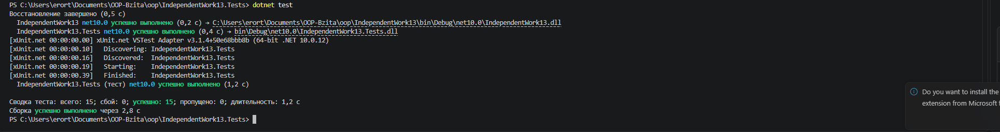

# Самостійна робота №13

> **Тема:** Узагальнений кеш Cache<TKey, TValue> із тестами
> **Студент:** Бзіта Олександр

---

## Зміст

- [Хід роботи та навички](#хід-роботи-та-навички)
- [Результати](#результати)
- [Контрольні запитання](#контрольні-запитання)

---

## Хід роботи та навички

### 1. Створив проєкти та посилання між ними
Створив консольний проєкт `IndependentWork7`, тестовий проєкт `IndependentWork7.Tests` на xUnit і додав посилання з тестів на основний проєкт.

```bash
dotnet new console -o IndependentWork7
dotnet new xunit -o IndependentWork7.Tests
dotnet add IndependentWork7.Tests reference IndependentWork7
```

### 2. Реалізував клас `Cache<TKey, TValue>`

| Елемент | Призначення |
|---------|-------------|
| `_capacity` | максимальна кількість елементів |
| `_cache` (`Dictionary<TKey, TValue>`) | зберігання пар ключ-значення |
| `_keysOrder` (`Queue<TKey>`) | порядок додавання ключів для політики FIFO |
| `Add` | додає елемент, а при переповненні видаляє найстаріший |
| `Get` | повертає значення або кидає `KeyNotFoundException` |
| `ContainsKey` | перевіряє наявність ключа |
| `Count` | поточна кількість елементів |

Рішення, які я прийняв під час реалізації:

- `Get` використовує `TryGetValue`, а не індексатор, щоб самому контролювати виняток.
- Якщо ключ уже є в кеші, `Add` лише оновлює значення. Порядок у черзі не змінюється, тому оновлення не робить елемент «новішим» (це відповідає FIFO).
- Конструктор кидає `ArgumentOutOfRangeException`, якщо ємність менша або дорівнює 0.

```csharp
public void Add(TKey key, TValue value)
{
    if (_cache.ContainsKey(key))
    {
        _cache[key] = value;
        return;
    }

    if (_cache.Count >= _capacity)
    {
        TKey oldestKey = _keysOrder.Dequeue();
        _cache.Remove(oldestKey);
    }

    _cache[key] = value;
    _keysOrder.Enqueue(key);
}
```

### 3. Написав юніт-тести

15 тестів (14 методів, один із них `Theory` з двома наборами даних):

| Що перевіряється | Тести |
|------------------|-------|
| Конструктор | `Constructor_NonPositiveCapacity_ThrowsArgumentOutOfRangeException` |
| Додавання | `Add_NewItem_IncreasesCount`, `Add_ExistingKey_UpdatesValueWithoutChangingCount`, `Add_ExistingKey_DoesNotRefreshItemAge` |
| Отримання | `Get_ExistingKey_ReturnsValue`, `Get_MissingKey_ThrowsKeyNotFoundException`, `Get_DoesNotChangeEvictionOrder` |
| `ContainsKey` | `ContainsKey_ExistingKey_ReturnsTrue`, `ContainsKey_MissingKey_ReturnsFalse` |
| `Count` | `Count_EmptyCache_ReturnsZero`, `Count_AfterOverflow_EqualsCapacity` |
| Переповнення (FIFO) | `Add_OverCapacity_RemovesOldestItem`, `Add_OverCapacity_KeepsNewerItems`, `Add_ManyItems_RemovesInInsertionOrder` |

### 4. Продемонстрував роботу в `Main`

Створив `Cache<string, string>` з ємністю 3, додав елементи, прочитав один із них, додав ще два, щоб кеш переповнився, і перевірив, що видаляються найстаріші елементи. Окремо показав, що читання через `Get` не рятує елемент від видалення, бо політика FIFO, а не LRU.

### 5. Запустив тести

```bash
dotnet test
```

---

## Результати



Фрагмент виводу `dotnet test`:

```
Passed!  - Failed:     0, Passed:    15, Skipped:     0, Total:    15
```

Вивід програми:

```
--- Демонстрація Cache<string, string> з ємністю 3 ---
Додано: ua, pl, de. Кількість елементів: 3
Get("pl") = Poland
Додаємо fr, кеш переповнений, найстаріший елемент (ua) видалено
ContainsKey("ua") = False
ContainsKey("fr") = True
Get("ua"): Ключ 'ua' не знайдено в кеші.
Додаємо it, видалено найстаріший (pl), хоча його щойно читали (FIFO)
ContainsKey("pl") = False
ContainsKey("de") = True
Кількість елементів: 3
```

---

## Контрольні запитання

| № | Питання | Відповідь |
|---|---------|-----------|
| 1 | Які переваги надає `Cache<TKey, TValue>` порівняно з окремими неузагальненими реалізаціями кешу? | Один клас працює з будь-якими типами ключа й значення, тому не треба писати окремий кеш для `string`, `int` чи власних класів. Типи перевіряються під час компіляції, тож помилка на кшталт запису `int` замість `string` не дійде до виконання. Немає боксингу значущих типів і приведення `object`, а це швидше й безпечніше. Тести теж пишуться один раз для всієї логіки. |
| 2 | Чому для реалізації політики FIFO зручно поєднувати `Dictionary<TKey, TValue>` з `Queue<TKey>` або `LinkedList<TKey>`? | `Dictionary` дає доступ за ключем за O(1), але не пам'ятає порядок додавання. `Queue` навпаки зберігає порядок: `Dequeue()` за O(1) повертає найстаріший ключ, який потім видаляється зі словника. Разом обидві операції (пошук і витіснення) виконуються за O(1). `LinkedList` потрібен для LRU, бо дозволяє за O(1) переносити вузол у кінець при кожному зверненні. |
| 3 | У яких випадках метод `Get` повинен викидати `KeyNotFoundException`, а коли доцільніше використовувати підхід на кшталт `TryGetValue`? | Виняток доречний, коли відсутність ключа означає помилку в логіці програми (ключ мав бути в кеші). Якщо ж відсутність ключа нормальна ситуація, як для кешу («промах кешу»), краще `TryGetValue`: він повертає `bool` і не витрачає час на створення винятку, який дорогий. У цій роботі за завданням `Get` кидає виняток, а `ContainsKey` дозволяє перевірити наявність наперед. |
| 4 | Які тести є критично важливими для перевірки політики витіснення елементів з кешу? | Тест, що при переповненні зникає саме найстаріший елемент, а не будь-який. Тест, що новіші елементи залишаються. Тест на багато додавань поспіль, де елементи видаляються в порядку вставки. Тест, що `Count` ніколи не перевищує ємність. Граничні випадки: оновлення наявного ключа не змінює вік елемента, а читання через `Get` не змінює порядок витіснення (на відміну від LRU). |

---

<div align="center">

*Самостійна робота виконана в рамках курсу ООП*
</div>