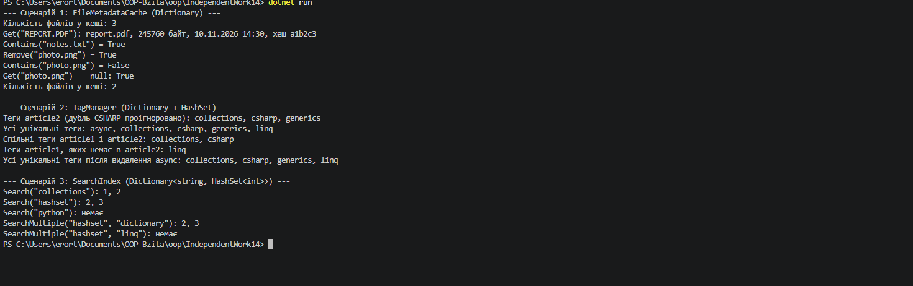

# Самостійна робота №14

> **Тема:** Вивчення Dictionary<TKey, TValue> та HashSet<T> у бібліотеках .NET
> **Студент:** Бзіта Олександр

---

## Зміст

- [Хід роботи та навички](#хід-роботи-та-навички)
- [Результати](#результати)
- [Звіт](#звіт)

---

## Хід роботи та навички

### 1. Створив проєкт
Ініціалізував консольний проєкт `IndependentWork14` через .NET CLI.

```bash
dotnet new console -o IndependentWork14
```

### 2. Проаналізував open-source проєкти
Знайшов по одному прикладу для `Dictionary<TKey, TValue>` (Dapper) і `HashSet<T>` (.NET Runtime, `System.Linq`). Аналіз і посилання наведені в [REPORT.md](REPORT.md).

### 3. Реалізував сценарій 1: `FileMetadataCache` (Dictionary)

- `FileMetadata` має поля `FileName`, `Size`, `LastModified`, `Hash`.
- `FileMetadataCache` зберігає метадані у `Dictionary<string, FileMetadata>` з ключем `FileName`.
- Методи: `Add`, `Get`, `Remove`, `Contains`, а також властивість `Count`.
- Словник створений з `StringComparer.OrdinalIgnoreCase`, тому імена файлів не залежать від регістру (`REPORT.PDF` і `report.pdf` це той самий файл).
- `Get` повертає `null`, якщо файлу немає, а `Remove` повертає `bool`.

### 4. Реалізував сценарій 2: `TagManager` (Dictionary + HashSet)

- Дані зберігаються в `Dictionary<string, HashSet<string>>` (ідентифікатор статті → множина тегів).
- `AddTag` створює множину для нової статті, а дублікати тегів ігноруються автоматично, у тому числі з іншим регістром.
- `RemoveTag` видаляє тег і прибирає статтю зі словника, якщо в неї не лишилось тегів.
- `GetAllUniqueTags` об'єднує множини через `UnionWith`.
- `FindCommonTags` знаходить спільні теги через `IntersectWith`.
- Додатково `FindUniqueTags` повертає теги однієї статті, яких немає в іншої, через `ExceptWith`.
- Усі методи повертають копії множин, щоб зовнішній код не міг змінити внутрішній стан класу.

### 5. Реалізував сценарій 3: `SearchIndex` (додатково)

Інвертований індекс `Dictionary<string, HashSet<int>>` (слово → множина документів). `AddDocument` розбиває текст на слова, `Search` повертає документи зі словом, а `SearchMultiple` перетинає множини через `IntersectWith` і зупиняється, коли перетин порожній.

### 6. Створив порівняльну таблицю та звіт

Порівняльна таблиця складності `List`, `Dictionary`, `HashSet` і висновки про вибір колекції лежать у [REPORT.md](REPORT.md).

---

## Результати


Вивід програми:

```
--- Сценарій 1: FileMetadataCache (Dictionary) ---
Кількість файлів у кеші: 3
Get("REPORT.PDF"): report.pdf, 245760 байт, 10.11.2026 14:30, хеш a1b2c3
Contains("notes.txt") = True
Remove("photo.png") = True
Contains("photo.png") = False
Get("photo.png") == null: True
Кількість файлів у кеші: 2

--- Сценарій 2: TagManager (Dictionary + HashSet) ---
Теги article2 (дубль CSHARP проігноровано): collections, csharp, generics
Усі унікальні теги: async, collections, csharp, generics, linq
Спільні теги article1 і article2: collections, csharp
Теги article1, яких немає в article2: linq
Усі унікальні теги після видалення async: collections, csharp, generics, linq

--- Сценарій 3: SearchIndex (Dictionary<string, HashSet<int>>) ---
Search("collections"): 1, 2
Search("hashset"): 2, 3
Search("python"): немає
SearchMultiple("hashset", "dictionary"): 2, 3
SearchMultiple("hashset", "linq"): немає
```

---

## Звіт

Повний звіт з аналізом open-source прикладів, порівняльною таблицею, висновками та відповідями на контрольні запитання: [REPORT.md](REPORT.md).

---

<div align="center">

*Самостійна робота виконана в рамках курсу ООП*
</div>