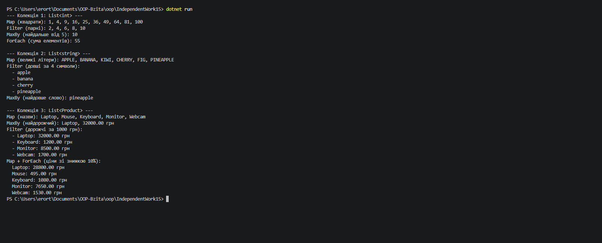

# Самостійна робота №15

> **Тема:** Делегати й лямбда-вирази: власні утиліти для колекцій
> **Студент:** Бзіта Олександр Варіант №2

---

## Зміст

- [Хід роботи та навички](#хід-роботи-та-навички)
- [Результати](#результати)
- [Звіт](#звіт)
- [Контрольні запитання](#контрольні-запитання)

---

## Хід роботи та навички

### 1. Створив проєкт
Ініціалізував консольний проєкт `lab9-self-v2` через .NET CLI.

```bash
dotnet new console -o lab9-self-v2
```

### 2. Реалізував статичний клас `CollectionUtils`

| Метод | Делегат | Аналог LINQ | Призначення |
|-------|---------|-------------|-------------|
| `Map<TSource, TResult>` | `Func<TSource, TResult>` | `Select` | перетворює кожен елемент |
| `MaxBy<T, TKey>` | `Func<T, TKey>` | `MaxBy` | знаходить елемент із максимальним ключем |
| `Filter<T>` | `Predicate<T>` | `Where` | залишає елементи, що задовольняють умову |
| `ForEach<T>` | `Action<T>` | `List<T>.ForEach` | виконує дію для кожного елемента |

Особливості реалізації:

- Усі методи перевіряють аргументи на `null` через `ArgumentNullException.ThrowIfNull`.
- `MaxBy` має обмеження `where TKey : IComparable<TKey>` і порівнює ключі через `CompareTo`. Якщо кілька елементів мають однаковий максимальний ключ, повертається перший з них. Для порожньої колекції кидається `InvalidOperationException`, бо повертати `default` було б оманливо (наприклад, `0` для `int`).
- `Map` і `Filter` збирають результат у `List` одразу, тобто виконуються негайно.

```csharp
public static IEnumerable<T> Filter<T>(IEnumerable<T> collection, Predicate<T> predicate)
{
    ArgumentNullException.ThrowIfNull(collection);
    ArgumentNullException.ThrowIfNull(predicate);

    var result = new List<T>();
    foreach (var item in collection)
    {
        if (predicate(item))
        {
            result.Add(item);
        }
    }

    return result;
}
```

### 3. Продемонстрував роботу на трьох колекціях

| Колекція | Що перевіряв |
|----------|--------------|
| `List<int>` | квадрати, парні числа, число найдальше від 5, сума через `ForEach` із замиканням |
| `List<string>` | великі літери, слова довші за 4 символи, найдовше слово |
| `List<Product>` | назви, найдорожчий товар, товари дорожчі за 1000 грн, ціни зі знижкою 10% через `Map` з анонімним типом |

---

## Результати


Вивід програми:

```
--- Колекція 1: List<int> ---
Map (квадрати): 1, 4, 9, 16, 25, 36, 49, 64, 81, 100
Filter (парні): 2, 4, 6, 8, 10
MaxBy (найдальше від 5): 10
ForEach (сума елементів): 55

--- Колекція 2: List<string> ---
Map (великі літери): APPLE, BANANA, KIWI, CHERRY, FIG, PINEAPPLE
Filter (довші за 4 символи):
  - apple
  - banana
  - cherry
  - pineapple
MaxBy (найдовше слово): pineapple

--- Колекція 3: List<Product> ---
Map (назви): Laptop, Mouse, Keyboard, Monitor, Webcam
MaxBy (найдорожчий): Laptop, 32000.00 грн
Filter (дорожчі за 1000 грн):
  - Laptop: 32000.00 грн
  - Keyboard: 1200.00 грн
  - Monitor: 8500.00 грн
  - Webcam: 1700.00 грн
Map + ForEach (ціни зі знижкою 10%):
  Laptop: 28800.00 грн
  Mouse: 495.00 грн
  Keyboard: 1080.00 грн
  Monitor: 7650.00 грн
  Webcam: 1530.00 грн
```

---

## Звіт

### Чому делегати корисні для створення таких утиліт?
Делегат дозволяє передати в метод поведінку як параметр. Метод `Filter` один раз описує обхід колекції, а що саме вважати «потрібним» вирішує код, який його викликає. Без делегатів довелося б писати окремий метод для кожної умови (`FilterEven`, `FilterExpensive` тощо) або окремий клас для кожної дії. Узагальнені типи (`T`, `TResult`) додають до цього незалежність від типу даних, тому ті самі чотири методи працюють для `int`, `string` і `Product`.

### Як лямбда-вирази спрощують виклик цих методів?
Лямбда-вираз дає змогу описати поведінку прямо в місці виклику, без окремого іменованого методу. Порівняння: `Filter(products, p => p.Price > 1000)` замість метода `static bool IsExpensive(Product p)` та виклику `Filter(products, IsExpensive)`. Тип параметра компілятор виводить сам, а лямбда ще й може використовувати локальні змінні (замикання): у демонстрації `ForEach(numbers, n => sum += n)` накопичує суму у змінну `sum`, яка оголошена поза лямбдою.

### Порівняння з вбудованими операторами LINQ

| Моє | LINQ | Різниця |
|-----|------|---------|
| `Map` | `Select` | Мій метод виконується негайно і повертає готовий `List`. `Select` виконується відкладено і обчислює елементи лише під час ітерації. |
| `Filter` | `Where` | Те саме: мій метод одразу будує список, `Where` ледачий. Крім того, `Where` дозволяє використати індекс елемента й оптимізований для масивів та списків. |
| `MaxBy` | `MaxBy` (.NET 6+) | Логіка однакова: один прохід за O(n). У моєму методі порожня колекція завжди кидає `InvalidOperationException`, а LINQ-версія для посилальних типів повертає `null`. Також LINQ підтримує власний компаратор. |
| `ForEach` | `List<T>.ForEach` | У LINQ немає `ForEach` для `IEnumerable<T>`, тому мій метод працює з будь-якою колекцією, а не лише зі списком. |

Висновок: мої методи повторюють основні ідеї LINQ і показують, як він працює всередині. Для реальних проєктів краще використовувати LINQ: він оптимізований, ледачий і має багато додаткових можливостей, які я не реалізовував.

---

## Контрольні запитання

| № | Питання | Відповідь |
|---|---------|-----------|
| 1 | Чому делегати є зручним механізмом для передавання поведінки в узагальнені методи? | Делегат є типом, який описує сигнатуру методу, тому будь-який метод або лямбда з підходящою сигнатурою можна передати як аргумент. Узагальнений метод залишається незмінним, а поведінка (умова, перетворення, дія) підставляється ззовні. Це усуває дублювання коду й дозволяє повторно використовувати один обхід колекції для різних задач. |
| 2 | У чому різниця між `Func<T, TResult>`, `Action<T>` та `Predicate<T>`? | `Func<T, TResult>` приймає значення типу `T` і повертає `TResult` (у `Map` і `MaxBy`). `Action<T>` приймає значення, але нічого не повертає (`void`), тому підходить для `ForEach`. `Predicate<T>` приймає значення і завжди повертає `bool`, тому використовується для умов (`Filter`). `Predicate<T>` по суті те саме, що `Func<T, bool>`, але має виразнішу назву. |
| 3 | Які переваги дає поєднання generic-методів і лямбда-виразів під час роботи з колекціями? | Один метод працює з будь-яким типом елементів, а компілятор перевіряє типи під час компіляції, без приведень і боксингу. Лямбда дає короткий запис поведінки прямо у виклику й може використовувати локальні змінні. Разом це робить код коротшим, безпечнішим і зрозумілішим. |
| 4 | У яких випадках власні утиліти на кшталт `Map` чи `Filter` корисно реалізувати самостійно, навіть якщо існує LINQ? | Коли потрібна інша поведінка, ніж у LINQ (наприклад, негайне виконання або власні винятки). Коли немає підходящого стандартного методу (наприклад, `ForEach` для `IEnumerable<T>`). Для навчання, щоб зрозуміти, як працюють делегати й узагальнення. У проєктах, де LINQ недоступний або заборонений (обмеження платформи чи стилю коду). |

---

<div align="center">

*Самостійна робота виконана в рамках курсу ООП*
</div>