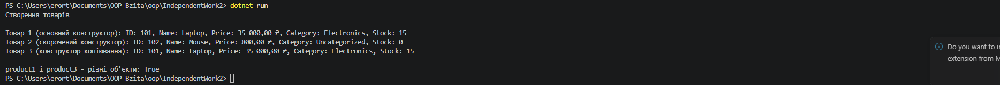

# Самостійна робота №2

> **Тема:** Перевантаження конструкторів: приклади та сценарії.

---

## Зміст

- [Хід роботи](#хід-роботи)
- [Результати](#результати)

---

## Хід роботи

### 1. Створив проєкт

```bash
dotnet new console -o IndependentWork2
```

### 2. Оголосив клас Product

- Приватні поля: `_id` (int), `_name` (string), `_price` (decimal), `_category` (string), `_stockCount` (int)
- Для всіх полів зробив read-only властивості (тільки `get`): `Id`, `Name`, `Price`, `Category`, `StockCount`. Після створення об'єкта дані змінити не можна.

### 3. Реалізував три перевантажені конструктори

- **Основний** — приймає всі 5 параметрів і ініціалізує поля.
- **Скорочений** — приймає тільки `id`, `name`, `price` і через `: this(...)` викликає основний, передаючи `"Uncategorized"` та `0`.
- **Копіювання** — приймає інший об'єкт `Product` і теж через `: this(...)` передає його дані в основний конструктор.

```csharp
public Product(int id, string name, decimal price, string category, int stockCount)
{
    _id = id;
    _name = name;
    _price = price;
    _category = category;
    _stockCount = stockCount;
}

public Product(int id, string name, decimal price) : this(id, name, price, "Uncategorized", 0)
{
}

public Product(Product other) : this(other.Id, other.Name, other.Price, other.Category, other.StockCount)
{
}
```

Вся ініціалізація полів знаходиться тільки в основному конструкторі, інші два його викликають, тому код не дублюється.

### 4. Перевизначив ToString()

```csharp
public override string ToString()
{
    return $"ID: {Id}, Name: {Name}, Price: {Price:C}, Category: {Category}, Stock: {StockCount}";
}
```

Щоб `:C` виводив ціну в гривнях, у `Main` встановив культуру `uk-UA`.

### 5. Продемонстрував роботу в Main

Створив 3 товари: перший основним конструктором, другий скороченим, третій — копія першого. Вивів кожен через `Console.WriteLine`, де автоматично викликається `ToString()`. Також перевірив через `ReferenceEquals`, що копія — це окремий об'єкт, а не те саме посилання.

---

## Результати


