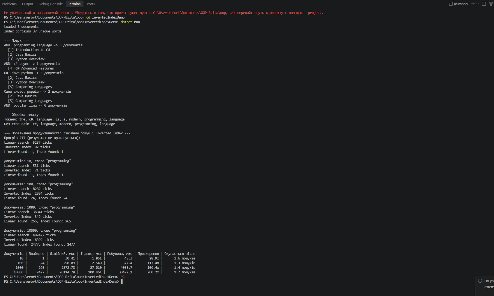

# Самостійна робота №16

> **Тема:** Колекції в практиці ООП: інвертований індекс і вимірювання продуктивності
> **Студент:** Бзіта Олександр

---

## Зміст

- [Хід роботи та навички](#хід-роботи-та-навички)
- [Результати](#результати)
- [Звіт](#звіт)

---

## Хід роботи та навички

### 1. Створив проєкт
Ініціалізував консольний проєкт `InvertedIndexDemo` через .NET CLI.

```bash
dotnet new console -o InvertedIndexDemo
```

### 2. Реалізував клас `Document`
Поля `Id`, `Title`, `Content` і `ToString()` у форматі `[Id] Title`.

### 3. Реалізував `TextProcessor`

- `Tokenize` переводить текст у нижній регістр і витягує слова регулярним виразом `\w+(?:#|\+\+)?`. Пунктуація зникає, а `C#` та `C++` лишаються цілими словами (інакше `C#` перетворилось би на `c`).
- `Normalize` повертає перший токен слова. Нею користуються і індекс, і лінійний пошук, щоб запит та текст нормалізувалися однаково.
- `RemoveStopWords` відкидає стоп-слова (`a`, `the`, `is` тощо). До індексу цей метод не застосовується, щоб слово `is` теж можна було знайти, а лінійний пошук і індекс давали однакові результати.

### 4. Реалізував `InvertedIndex`

| Елемент | Призначення |
|---------|-------------|
| `_index` (`Dictionary<string, HashSet<int>>`) | слово → множина ідентифікаторів документів |
| `_documents` (`Dictionary<int, Document>`) | швидкий доступ до документа за `Id` |
| `AddDocument` | зберігає документ, токенізує текст і додає `Id` до множини кожного слова |
| `SearchSingleWord` | документи, що містять слово |
| `SearchMultipleWords` (AND) | послідовний `HashSet.IntersectWith` по множинах слів |
| `SearchAnyWord` (OR) | `HashSet.UnionWith` по множинах слів |
| `DocumentCount`, `UniqueWords` | кількість документів і унікальних слів |

Додаткові рішення: повторне додавання документа з тим самим `Id` кидає `ArgumentException`, а результати пошуку відсортовані за `Id`.

```csharp
public List<Document> SearchMultipleWords(params string[] words)
{
    HashSet<int>? result = null;

    foreach (string word in words)
    {
        string normalized = TextProcessor.Normalize(word);

        if (!_index.TryGetValue(normalized, out HashSet<int>? ids))
        {
            return new List<Document>();
        }

        if (result == null)
        {
            result = new HashSet<int>(ids);
        }
        else
        {
            result.IntersectWith(ids);
        }
    }

    return result == null ? new List<Document>() : ToDocuments(result);
}
```

### 5. Створив тестові дані
П'ять документів із завдання (`SampleDocuments.GetBaseDocuments`) і генератор `SampleDocuments.Generate(count)`: кожен документ складається з 8-15 випадкових слів зі словника на 40 слів. Використовується `Random` з `Seed = 42`, тому набір документів відтворюється.

### 6. Виміряв продуктивність
`PerformanceTest.CompareSearchMethods` порівнює лінійний пошук (`documents.Where(d => Tokenize(d.Content).Contains(word))`) та пошук за індексом для 10, 100, 1000 і 10000 документів. Нормалізація однакова для обох підходів. Перед вимірюванням виконується прогрів JIT, а середній час рахується за кількома повторами (20 для лінійного пошуку, 10000 для індексу), бо одиничний вимір на таких малих часах ненадійний. Окремо вимірюється час побудови індексу і рахується, після скількох пошуків індекс окупається. Кількість знайдених документів порівнюється для обох підходів.

### 7. Інтерактивний режим (додатково)
Запуск з аргументом `interactive` відкриває консольний інтерфейс із запитом AND-пошуку:

```bash
dotnet run -- interactive
```

---

## Результати


Вивід програми:

```
Loaded 5 documents
Index contains 37 unique words

--- Пошук ---
AND: programming language -> 3 документів
  [1] Introduction to C#
  [2] Java Basics
  [3] Python Overview
AND: c# async -> 1 документів
  [4] C# Advanced Features
OR: java python -> 3 документів
  [2] Java Basics
  [3] Python Overview
  [5] Comparing Languages
Одне слово: popular -> 2 документів
  [2] Java Basics
  [5] Comparing Languages
AND: popular linq -> 0 документів

--- Обробка тексту ---
Токени: the, c#, language, is, a, modern, programming, language
Без стоп-слів: c#, language, modern, programming, language

--- Порівняння продуктивності: лінійний пошук і Inverted Index ---
Прогрів JIT (результат не враховується):
Linear search: 5237 ticks
Inverted Index: 92 ticks
Linear found: 1, Index found: 1

Документів: 10, слово "programming"
Linear search: 531 ticks
Inverted Index: 71 ticks
Linear found: 1, Index found: 1

Документів: 100, слово "programming"
Linear search: 8282 ticks
Inverted Index: 2994 ticks
Linear found: 24, Index found: 24

Документів: 1000, слово "programming"
Linear search: 36041 ticks
Inverted Index: 349 ticks
Linear found: 265, Index found: 265

Документів: 10000, слово "programming"
Linear search: 482427 ticks
Inverted Index: 6399 ticks
Linear found: 2477, Index found: 2477

Документів | Знайдено | Лінійний, мкс | Індекс, мкс | Побудова, мкс | Прискорення | Окупається після
        10 |        1 |         30.41 |       1.051 |          48.3 |       28.9x |      1.6 пошуків
       100 |       24 |        298.09 |       2.540 |         377.4 |      117.4x |      1.3 пошуків
      1000 |      265 |       2872.78 |      27.010 |        4035.7 |      106.4x |      1.4 пошуків
     10000 |     2477 |      20114.78 |     100.461 |       33472.1 |      200.2x |      1.7 пошуків
```

Час залежить від комп'ютера, але співвідношення між підходами зберігається.

Інтерактивний режим (`dotnet run -- interactive`):

```
Enter search query (or 'exit'): programming language

--- Search Results (AND) ---
[1] Introduction to C#
  C# is a modern object-oriented programming language developed by Microsoft....
[2] Java Basics
  Java is a popular programming language known for its portability and performance....
[3] Python Overview
  Python is a high-level programming language with simple syntax....

Found 3 documents

Enter search query (or 'exit'): c# async

--- Search Results (AND) ---
[4] C# Advanced Features
  C# supports LINQ, async/await, and many modern programming paradigms....

Found 1 documents

Enter search query (or 'exit'): exit
```

---

## Звіт

Опис реалізації, таблиця результатів вимірювань для 10 і 1000 документів, висновки та відповіді на контрольні запитання: [REPORT.md](REPORT.md).

---

<div align="center">

*Самостійна робота виконана в рамках курсу ООП*
</div>

