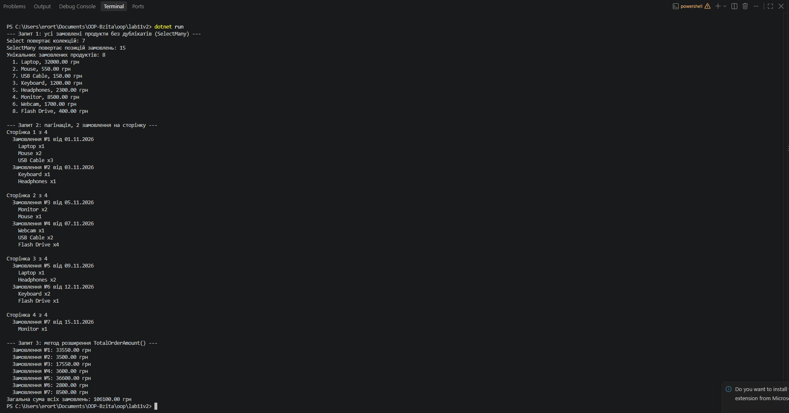

# Лабораторна робота №11

> **Тема:** LINQ: SelectMany, пагінація й custom extensions
> **Студент:** Бзіта Олександр Варіант №2 (Замовлення та деталі замовлень з продуктами)

---

## Зміст

- [Хід роботи та навички](#хід-роботи-та-навички)
- [Результати](#результати)
- [Контрольні запитання](#контрольні-запитання)

---

## Хід роботи та навички

### 1. Створив проєкт
Ініціалізував консольний проєкт `lab17v2` у директорії `OOP-Bzita` через .NET CLI.

```bash
dotnet new console -o OOP-Bzita/lab17v2
```

### 2. Розподілив підзадачі між можливостями LINQ

| Запит варіанта | Можливість | Принцип |
|----------------|------------|---------|
| Усі замовлені продукти без дублікатів | `SelectMany` + `Select` + `DistinctBy` | Розгортання вкладених списків позицій в одну послідовність |
| Замовлення по 2 на сторінку | `Skip` + `Take` | Пропуск попередніх сторінок і вибірка однієї |
| Загальна сума замовлення | метод розширення `TotalOrderAmount()` | Бізнес-логіка для `IEnumerable<OrderDetail>` |

### 3. Створив класи сутностей

- `Product` має поля `Id`, `Name`, `Price`.
- `OrderDetail` має поля `Id`, `ProductId`, `Quantity` та посилання `Product` на продукт, щоб знати ціну без додаткового пошуку.
- `Order` має поля `Id`, `OrderDate` та вкладену колекцію `List<OrderDetail> Details`.

Властивості лише для читання, значення задаються через конструктор.

### 4. Заповнив тестові дані

9 продуктів, 7 замовлень і 15 позицій замовлень. Продукт «Microphone» не замовлявся жодного разу, а решта 8 продуктів зустрічаються в кількох замовленнях, тому дублікати є що відфільтровувати.

| Замовлення | Дата | Кількість позицій |
|------------|------|-------------------|
| №1 | 01.11.2026 | 3 |
| №2 | 03.11.2026 | 2 |
| №3 | 05.11.2026 | 2 |
| №4 | 07.11.2026 | 3 |
| №5 | 09.11.2026 | 2 |
| №6 | 12.11.2026 | 2 |
| №7 | 15.11.2026 | 1 |

### 5. Реалізував запит 1: SelectMany

Усі замовлені продукти в одному списку без дублікатів.

```csharp
var orderedProducts = orders
    .SelectMany(o => o.Details)
    .Select(d => d.Product)
    .DistinctBy(p => p.Id)
    .ToList();
```

Для порівняння з `Select` виводжу кількість елементів в обох варіантах: `Select` повертає 7 вкладених колекцій, а `SelectMany` розгортає їх у 15 окремих позицій.

```csharp
int nestedCollections = orders.Select(o => o.Details).Count();
int flatDetails = orders.SelectMany(o => o.Details).Count();
```

### 6. Реалізував запит 2: пагінація

Замовлення по 2 на сторінку. Кількість сторінок рахується через `Math.Ceiling`, а кожна сторінка вибирається парою `Skip` + `Take`.

```csharp
const int pageSize = 2;
int totalPages = (int)Math.Ceiling(orders.Count / (double)pageSize);

for (int page = 1; page <= totalPages; page++)
{
    var pageOrders = orders
        .Skip((page - 1) * pageSize)
        .Take(pageSize)
        .ToList();
}
```

Остання сторінка містить лише 1 замовлення, бо 7 не ділиться на 2 націло. `Take` просто повертає менше елементів і не кидає помилку.

### 7. Реалізував запит 3: метод розширення

`TotalOrderAmount()` для `IEnumerable<OrderDetail>` рахує суму `Price * Quantity` по всіх позиціях.

```csharp
public static class OrderDetailExtensions
{
    public static decimal TotalOrderAmount(this IEnumerable<OrderDetail> details)
    {
        return details.Sum(d => d.Product.Price * d.Quantity);
    }
}
```

Метод працює і для одного замовлення, і для всіх позицій одразу:

```csharp
decimal orderTotal = order.Details.TotalOrderAmount();
decimal grandTotal = orders.SelectMany(o => o.Details).TotalOrderAmount();
```

### 8. Продемонстрував роботу в Main

У `Main` по черзі виводяться результати `SelectMany`, усі сторінки пагінації та суми замовлень, обчислені власним методом розширення.

---

## Результати


Фрагмент виводу:

```
--- Запит 1: усі замовлені продукти без дублікатів (SelectMany) ---
Select повертає колекцій: 7
SelectMany повертає позицій замовлень: 15
Унікальних замовлених продуктів: 8
  1. Laptop, 32000.00 грн
  2. Mouse, 550.00 грн
  7. USB Cable, 150.00 грн
  3. Keyboard, 1200.00 грн
  5. Headphones, 2300.00 грн
  4. Monitor, 8500.00 грн
  6. Webcam, 1700.00 грн
  8. Flash Drive, 400.00 грн

--- Запит 2: пагінація, 2 замовлення на сторінку ---
Сторінка 1 з 4
  Замовлення №1 від 01.11.2026
    Laptop x1
    Mouse x2
    USB Cable x3
  Замовлення №2 від 03.11.2026
    Keyboard x1
    Headphones x1

Сторінка 2 з 4
  Замовлення №3 від 05.11.2026
    Monitor x2
    Mouse x1
  Замовлення №4 від 07.11.2026
    Webcam x1
    USB Cable x2
    Flash Drive x4

...

Сторінка 4 з 4
  Замовлення №7 від 15.11.2026
    Monitor x1

--- Запит 3: метод розширення TotalOrderAmount() ---
  Замовлення №1: 33550.00 грн
  Замовлення №2: 3500.00 грн
  Замовлення №3: 17550.00 грн
  Замовлення №4: 3600.00 грн
  Замовлення №5: 36600.00 грн
  Замовлення №6: 2800.00 грн
  Замовлення №7: 8500.00 грн
Загальна сума всіх замовлень: 106100.00 грн
```

---

## Контрольні запитання

| № | Питання | Відповідь |
|---|---------|-----------|
| 1 | Для чого використовується оператор `SelectMany`? Наведіть приклад, що демонструє його відмінність від `Select`. | `SelectMany` проєктує кожен елемент у колекцію й одразу об'єднує (розгортає) всі ці колекції в одну плоску послідовність. `Select` залишає вкладеність: з 7 замовлень він поверне 7 списків позицій (`IEnumerable<List<OrderDetail>>`), а `SelectMany` поверне одну послідовність із 15 позицій (`IEnumerable<OrderDetail>`). Тому для списку всіх позицій усіх замовлень пишу `orders.SelectMany(o => o.Details)`. |
| 2 | Як реалізувати пагінацію даних за допомогою LINQ? Які методи для цього використовуються? | Використовуються `Skip(n)` і `Take(n)`. Для сторінки з номером `page` і розміром `pageSize` пишу `Skip((page - 1) * pageSize).Take(pageSize)`: спочатку пропускаються всі елементи попередніх сторінок, потім береться потрібна кількість. Кількість сторінок дорівнює `Math.Ceiling(count / (double)pageSize)`. Якщо елементів на останній сторінці менше, `Take` просто поверне їх скільки є. Для стабільної пагінації порядок елементів має бути однаковим між викликами, тому за потреби перед `Skip` додається `OrderBy`. |
| 3 | Поясніть концепцію методів розширення. Як вони інтегруються з LINQ? | Методи розширення дозволяють додати новий метод до наявного типу, не змінюючи його вихідний код і не створюючи нащадка. Це статичний метод у статичному класі, перший параметр якого має модифікатор `this`. Сам LINQ побудований на них: `Where`, `Select`, `SelectMany`, `Skip`, `Take` є методами розширення для `IEnumerable<T>` у класі `Enumerable`. Тому власний метод для `IEnumerable<T>` викликається в одному ланцюжку з ними: `orders.SelectMany(o => o.Details).TotalOrderAmount()`. |
| 4 | Наведіть приклад власного методу розширення для `IEnumerable<T>` та поясніть його призначення. | У роботі це `TotalOrderAmount(this IEnumerable<OrderDetail> details)`, який повертає `details.Sum(d => d.Product.Price * d.Quantity)`. Він виносить бізнес-логіку підрахунку суми в одне місце, і її не треба повторювати в кожному запиті. Працює і для позицій одного замовлення, і для всіх позицій усіх замовлень одразу. |

---

<div align="center">

*Лабораторна робота виконана в рамках курсу ООП*
</div>