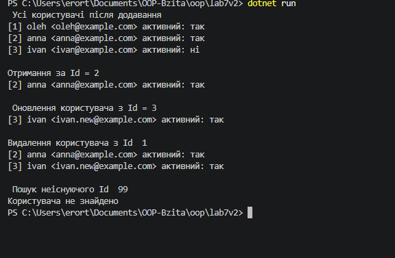

# Лабораторна робота №7

> **Тема:** Узагальнені типи (Generics). `IRepository` з `where`-обмеженнями та тестами
> **Студент:** Варіант №2 (Сутність `User`)

---

## Зміст

- [Хід роботи та навички](#хід-роботи-та-навички)
- [Результати](#результати)
- [Контрольні запитання](#контрольні-запитання)

---

## Хід роботи та навички

### 1. Створив проєкти
Ініціалізував консольний проєкт `lab7v2` та окремий проєкт для тестів `lab7v2.Tests` (xUnit) у директорії `OOP-Bzita/oop`, після чого додав у тестовий проєкт посилання на основний.

```bash
dotnet new console -o OOP-Bzita/oop/lab7v2
dotnet new xunit -o OOP-Bzita/oop/lab7v2.Tests
cd OOP-Bzita/oop/lab7v2.Tests
dotnet add reference ../lab7v2/lab7v2.csproj
```

### 2. Реалізував узагальнений інтерфейс `IRepository<T>`

- Створив інтерфейс `IEntity` з єдиною властивістю `int Id { get; set; }`.
- Описав `IRepository<T>` з методами `GetById`, `GetAll`, `Add`, `Update`, `Delete`.
- Наклав на тип `T` обмеження `where T : class, IEntity`, щоб репозиторій працював лише з класами, які мають `Id`.

```csharp
public interface IEntity
{
    int Id { get; set; }
}

public interface IRepository<T> where T : class, IEntity
{
    T? GetById(int id);
    IEnumerable<T> GetAll();
    void Add(T item);
    void Update(T item);
    void Delete(int id);
}
```

### 3. Реалізував `InMemoryRepository<T>`

- Зберігання даних організував у приватному `List<T>`.
- У `Add` автоматично призначається наступний вільний `Id`, а при дублікаті `Id` кидається `InvalidOperationException`.
- `GetById` для неіснуючого `Id` повертає `null`.
- `Update` та `Delete` для неіснуючого елемента кидають `KeyNotFoundException`.
- `GetAll` повертає копію списку, щоб зовнішній код не міг змінити внутрішню колекцію.

```csharp
public class InMemoryRepository<T> : IRepository<T> where T : class, IEntity
{
    private readonly List<T> _items = new List<T>();
    private int _nextId = 1;

    public T? GetById(int id)
    {
        return _items.FirstOrDefault(item => item.Id == id);
    }

    public IEnumerable<T> GetAll()
    {
        return _items.ToList();
    }
}
```

### 4. Створив сутність `User`

Клас `User` реалізує `IEntity` і містить властивості `Username`, `Email`, `IsActive`, а також конструктор для їх ініціалізації.

```csharp
public class User : IEntity
{
    public int Id { get; set; }
    public string Username { get; set; }
    public string Email { get; set; }
    public bool IsActive { get; set; }

    public User(string username, string email, bool isActive)
    {
        Username = username;
        Email = email;
        IsActive = isActive;
    }
}
```

### 5. Написав юніт-тести

У проєкті `lab7v2.Tests` створив 12 тестів на всі методи репозиторію, з перевіркою як звичайної поведінки, так і граничних випадків.

| Метод | Що перевіряють тести |
|-------|----------------------|
| `Add` | додавання й автоматичний `Id`, унікальність `Id`, дублікат `Id`, `null` |
| `GetById` | існуючий `Id`, неіснуючий `Id` (повертає `null`) |
| `GetAll` | порожній репозиторій, репозиторій з елементами |
| `Update` | оновлення існуючого, оновлення неіснуючого (виняток) |
| `Delete` | видалення існуючого, видалення неіснуючого (виняток) |

```csharp
[Fact]
public void Delete_NonExistingId_ThrowsKeyNotFoundException()
{
    var repository = new InMemoryRepository<User>();

    Assert.Throws<KeyNotFoundException>(() => repository.Delete(99));
}
```

Запуск тестів:

```bash
dotnet test
```

### 6. Продемонстрував роботу в `Main`

Створив `InMemoryRepository<User>`, додав трьох користувачів, отримав одного за `Id`, оновив, видалив і вивів результати в консоль.

---

## Результати

### Вивід програми



### Результат тестів


---

## Контрольні запитання

| № | Питання | Відповідь |
|---|---------|-----------|
| 1 | Яка роль `where`-обмежень у Generics? Наведіть приклади їх використання. | Обмеження вказують, якими мають бути типи, що підставляються замість `T`, і дозволяють користуватися їхніми можливостями всередині узагальненого коду. Приклади: `where T : class` (лише посилальні типи), `where T : struct` (лише значущі), `where T : new()` (є конструктор без параметрів), `where T : IEntity` (реалізує інтерфейс). У лабі `where T : class, IEntity` гарантує, що в `T` є властивість `Id`. |
| 2 | Навіщо потрібен шаблон `IRepository`? Які переваги він дає? | Він відокремлює логіку доступу до даних від решти програми. Можна замінити сховище (пам'ять, база даних, файл) без зміни іншого коду, а також легко підставляти тестове сховище в юніт-тестах. |
| 3 | Поясніть, чому юніт-тести є важливими при розробці узагальнених компонентів. | Один узагальнений клас працює з багатьма типами, тому помилка в ньому проявиться всюди. Тести швидко перевіряють усі методи й граничні випадки (неіснуючий `Id`, дублікат) та одразу показують, якщо після змін щось зламалося. |
| 4 | Які проблеми вирішують Generics порівняно з використанням `object`? | Не потрібне приведення типів і можна не боятися `InvalidCastException`, бо помилки типів ловить компілятор ще до запуску. Немає боксингу для значущих типів, що пришвидшує роботу. Код читабельніший: видно, з яким типом працює колекція чи репозиторій. |

---

<div align="center">

*Лабораторна робота виконана в рамках курсу ООП*
</div>