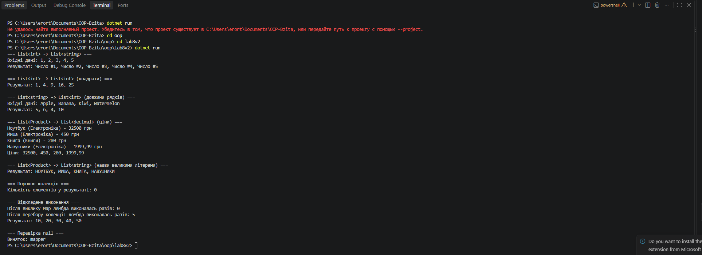

# Лабораторна робота №8

> **Тема:** Делегати й лямбда-вирази у практиці колекцій: `CollectionHelper<T>`
> **Студент:** Варіант №2 (Метод `Map`)

---

## Зміст

- [Хід роботи та навички](#хід-роботи-та-навички)
- [Результати](#результати)
- [Контрольні запитання](#контрольні-запитання)

---

## Хід роботи та навички

### 1. Створив проєкт
Ініціалізував консольний проєкт `lab8v2` у директорії `OOP-Bzita/oop/lab8v2` через .NET CLI.

```bash
dotnet new console -o OOP-Bzita/oop/lab8v2
```

### 2. Реалізував `CollectionHelper<T>` з методом `Map`

За варіантом реалізовано метод `Map`, який перетворює кожен елемент колекції типу `T` на елемент типу `TResult` за допомогою делегата `Func<T, TResult>`.

- Створив статичний узагальнений клас `CollectionHelper<T>`.
- Реалізував логіку власним кодом: цикл `foreach` та оператор `yield return`, без виклику LINQ-оператора `Select`.
- Додав перевірку аргументів: при `null` кидається `ArgumentNullException`.
- Перевірку винесено в публічний метод, а ітерацію у приватний `MapIterator`. Інакше через `yield return` виняток спрацював би не під час виклику, а лише при першому переборі.

```csharp
public static class CollectionHelper<T>
{
    public static IEnumerable<TResult> Map<TResult>(IEnumerable<T> collection, Func<T, TResult> mapper)
    {
        if (collection == null)
        {
            throw new ArgumentNullException(nameof(collection));
        }

        if (mapper == null)
        {
            throw new ArgumentNullException(nameof(mapper));
        }

        return MapIterator(collection, mapper);
    }

    private static IEnumerable<TResult> MapIterator<TResult>(IEnumerable<T> collection, Func<T, TResult> mapper)
    {
        foreach (T item in collection)
        {
            yield return mapper(item);
        }
    }
}
```

### 3. Створив власний клас `Product`

Клас містить властивості `Id`, `Name`, `Category`, `Price` та конструктор для їх ініціалізації.

### 4. Продемонстрував роботу в `Main`

Викликав `Map` для колекцій різних типів, передаючи лямбда-вирази:

| Колекція | Лямбда | Результат |
|----------|--------|-----------|
| `List<int>` → `List<string>` | `n => $"Число #{n}"` | `Число #1, Число #2, ...` |
| `List<int>` → `List<int>` | `n => n * n` | `1, 4, 9, 16, 25` |
| `List<string>` → `List<int>` | `w => w.Length` | `5, 6, 4, 10` |
| `List<Product>` → `List<decimal>` | `p => p.Price` | `32500, 450, 280, 1999.99` |
| `List<Product>` → `List<string>` | `p => p.Name.ToUpper()` | `НОУТБУК, МИША, ...` |

```csharp
List<decimal> prices = new List<decimal>(CollectionHelper<Product>.Map(products, p => p.Price));
```

Також перевірив граничні випадки: порожню колекцію (результат порожній), відкладене виконання (лямбда не викликається до перебору колекції) та передачу `null` замість делегата.

---

## Результати



---

## Контрольні запитання

| № | Питання | Відповідь |
|---|---------|-----------|
| 1 | Що таке делегат і для чого він використовується? | Делегат — це тип, що зберігає посилання на метод із певною сигнатурою (параметри й тип повернення). Він дозволяє передавати методи як параметри, зберігати їх у змінних і викликати пізніше. Використовується для колбеків, подій, а також для передавання поведінки у методи, як у `Map`, де делегат `Func<T, TResult>` описує, як перетворювати елементи. |
| 2 | У чому полягає різниця між `Func` та `Action`? | `Func` приймає параметри й повертає значення (останній тип-параметр є типом результату), наприклад `Func<int, string>`. `Action` приймає параметри, але нічого не повертає (`void`), наприклад `Action<string>`. Також є `Predicate<T>`, що приймає один параметр і повертає `bool`. |
| 3 | Як лямбда-вирази спрощують роботу з делегатами? | Лямбда дозволяє записати метод прямо на місці виклику, без окремого іменованого методу й без оголошення делегата. Запис `n => n * n` замінює цілий метод, а типи параметрів компілятор виводить сам. Також лямбда може використовувати змінні навколишнього коду (замикання). |
| 4 | Які переваги дають узагальнені методи при роботі з колекціями? | Один метод працює з будь-яким типом елементів (`int`, `string`, `Product`) без дублювання коду. Типи перевіряються під час компіляції, не потрібні приведення типів і боксинг. Наприклад, один `Map` перетворює `List<int>` на `List<string>`, а `List<Product>` на `List<decimal>`. |

---

<div align="center">

*Лабораторна робота виконана в рамках курсу ООП*
</div>