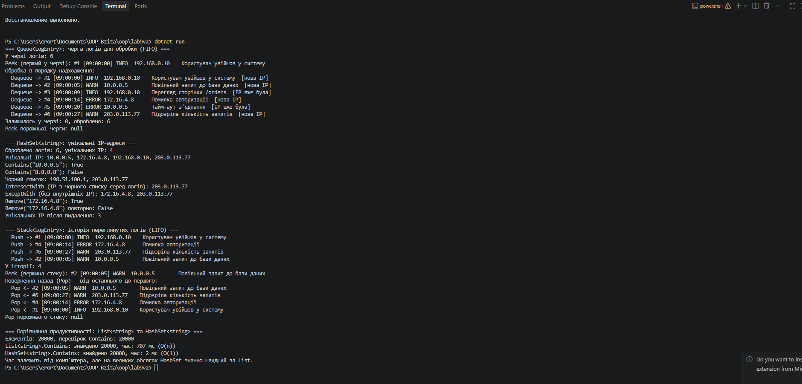

# Лабораторна робота №9

> **Тема:** `HashSet` / `Queue` / `Stack`: практичні сценарії
> **Студент:** Варіант №2 (Обробка логів)

---

## Зміст

- [Хід роботи та навички](#хід-роботи-та-навички)
- [Результати](#результати)
- [Контрольні запитання](#контрольні-запитання)

---

## Хід роботи та навички

### 1. Створив проєкт
Ініціалізував консольний проєкт `lab9v2` у директорії `OOP-Bzita/oop/lab9v2` через .NET CLI.

```bash
dotnet new console -o OOP-Bzita/oop/lab9v2
```

### 2. Розподілив підзадачі між колекціями

| Колекція | Підзадача варіанта | Принцип |
|----------|--------------------|---------|
| `HashSet<string>` | Унікальні IP-адреси | Унікальність, швидка перевірка наявності |
| `Queue<LogEntry>` | Черга логів для обробки | FIFO: перший прийшов, перший оброблений |
| `Stack<LogEntry>` | Історія переглянутих логів | LIFO: останній переглянутий повертається першим |

### 3. Створив клас `LogEntry`

Клас описує запис журналу: `Id`, `Timestamp`, `IpAddress`, `Level`, `Message`, а також має перевизначений `ToString()` для зручного виводу.

### 4. Реалізував `Queue`: черга логів

- `Enqueue` додає лог у кінець черги.
- `PeekNext` показує перший лог, не видаляючи його.
- `ProcessNext` забирає лог із початку через `TryDequeue` (безпечно для порожньої черги) та передає його IP в `HashSet`.

```csharp
public LogEntry? ProcessNext(out bool isNewIp)
{
    isNewIp = false;

    if (!_pendingLogs.TryDequeue(out LogEntry? entry))
    {
        return null;
    }

    isNewIp = _uniqueIps.Add(entry.IpAddress);
    _processedLogs.Add(entry);
    return entry;
}
```

### 5. Реалізував `HashSet`: унікальні IP-адреси

- `Add` повертає `false`, якщо IP вже є: так визначається, чи адреса нова.
- `Contains` перевіряє, чи бачили адресу раніше, а `Remove` видаляє її.
- `IntersectWith` знаходить IP з чорного списку, `ExceptWith` виключає внутрішні адреси.
- Методи повертають копії множини, щоб зовнішній код не міг змінити внутрішні дані.

```csharp
public HashSet<string> FindBlacklistedIps(IEnumerable<string> blacklist)
{
    HashSet<string> result = GetUniqueIps();
    result.IntersectWith(blacklist);
    return result;
}
```

### 6. Реалізував `Stack`: історія переглянутих логів

- `View` додає переглянутий лог на вершину (`Push`).
- `PeekLastViewed` показує вершину без видалення (`Peek`).
- `GoBack` знімає вершину (`Pop`) і повертає користувача до попереднього логу, як кнопка «Назад».

```csharp
public LogEntry? GoBack()
{
    return _viewHistory.TryPop(out LogEntry? entry) ? entry : null;
}
```

### 7. Порівняв продуктивність

Виконав 20 000 перевірок `Contains` на колекції з 20 000 IP-адрес. Пошук у `List<string>` займає лінійний час O(n), а в `HashSet<string>` у середньому O(1).

| Колекція | Складність `Contains` | Час (орієнтовно) |
|----------|-----------------------|------------------|
| `List<string>` | O(n) | ~816 мс |
| `HashSet<string>` | O(1) | ~2 мс |

Час залежить від комп'ютера, але різниця між колекціями завжди суттєва.

---

## Результати


Фрагмент виводу:

```
Обробка в порядку надходження:
  Dequeue -> #1 [09:00:00] INFO  192.168.0.10    Користувач увійшов у систему  [нова IP]
  Dequeue -> #2 [09:00:05] WARN  10.0.0.5        Повільний запит до бази даних  [нова IP]
  Dequeue -> #3 [09:00:09] INFO  192.168.0.10    Перегляд сторінки /orders  [IP вже була]

Унікальні IP: 10.0.0.5, 172.16.4.8, 192.168.0.10, 203.0.113.77
IntersectWith (IP з чорного списку серед логів): 203.0.113.77

Повернення назад (Pop) - від останнього до першого:
  Pop <- #2 [09:00:05] WARN  10.0.0.5        Повільний запит до бази даних
  Pop <- #6 [09:00:27] WARN  203.0.113.77    Підозріла кількість запитів
```

---

## Контрольні запитання

| № | Питання | Відповідь |
|---|---------|-----------|
| 1 | У чому різниця між `List<T>` та `HashSet<T>`? | `List<T>` зберігає елементи в порядку додавання, допускає дублікати й дає доступ за індексом, але пошук елемента займає O(n). `HashSet<T>` зберігає лише унікальні елементи без гарантованого порядку, не має індексів, зате пошук, додавання й видалення виконуються в середньому за O(1). Також `HashSet` має операції над множинами (`UnionWith`, `IntersectWith`, `ExceptWith`). |
| 2 | Коли доцільно використовувати `Queue<T>` замість `List<T>`? | Коли елементи потрібно обробляти строго в порядку надходження: черги завдань, друку, повідомлень, логів. У `Queue` видалення з початку (`Dequeue`) виконується за O(1), а в `List` `RemoveAt(0)` зсуває всі елементи (O(n)). До того ж інтерфейс `Queue` прямо виражає намір, і неможливо випадково звернутися до середини черги. |
| 3 | Наведіть приклад реальної задачі, де потрібен `Stack<T>`. | Кнопка «Назад» у браузері, скасування дій (Undo/Redo) у текстових редакторах, перевірка збалансованості дужок у виразі, обхід дерева в глибину (DFS), стек викликів методів. У лабі це історія переглянутих логів: останній переглянутий лог повертається першим. |
| 4 | Яка складність операції `Contains()` для `HashSet<T>` і чому? | У середньому O(1). `HashSet` обчислює хеш-код елемента й за ним одразу переходить до потрібної комірки (кошика), а не перебирає всі елементи. У найгіршому випадку, коли багато елементів мають однаковий хеш (колізії), складність деградує до O(n). Для порівняння, `List<T>.Contains` завжди перебирає елементи: O(n). |
| 5 | Чому `Queue<T>` називають FIFO, а `Stack<T>` — LIFO? | `Queue` працює за принципом First In, First Out: перший доданий елемент першим же видаляється, як черга в магазині. `Stack` працює за принципом Last In, First Out: останній доданий елемент видаляється першим, як стопка тарілок, де беруть верхню. |

---

<div align="center">

*Лабораторна робота виконана в рамках курсу ООП*
</div>